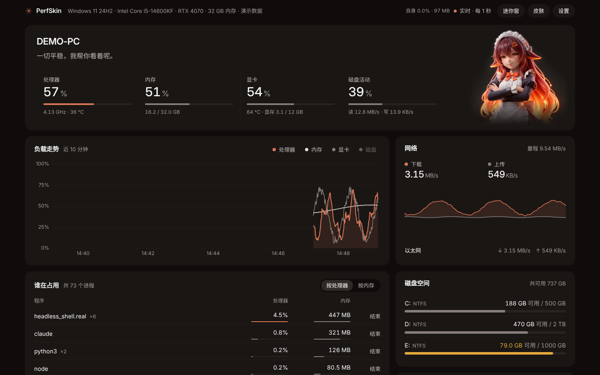
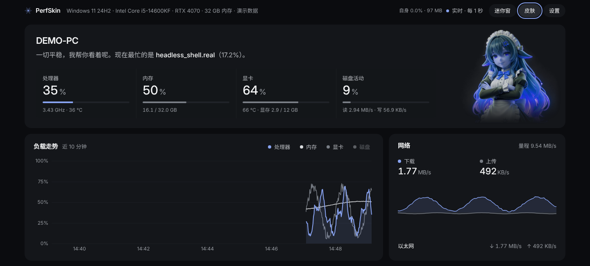
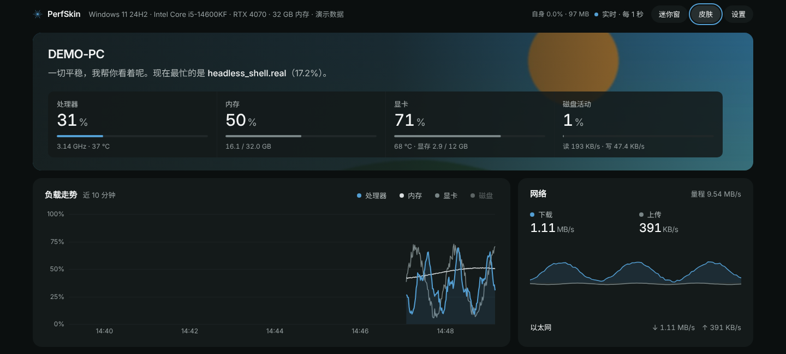
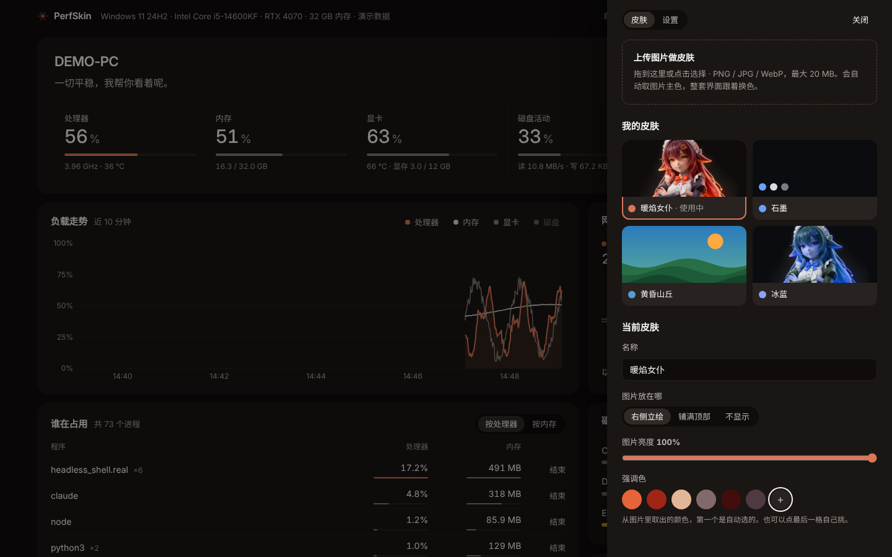

# PerfSkin

**可以换皮肤的 Windows 性能监控。** 上传一张你喜欢的图，整套界面自动换成和图片匹配的底色和强调色；
平时安静地待在托盘里，后台占用只有零点几个百分点的 CPU。

[English](#english) · [下载](https://github.com/FrankHuahua/PerfSkin/releases) · [更新记录](CHANGELOG.md)



## 能做什么

| | |
|---|---|
| **一眼看懂** | 第一屏就是答案：处理器、内存、显卡、磁盘四个数字，加一句结论——“一切平稳，最忙的是 chrome（3.4%）”，或者“CPU 正在全力奔跑（92%）” |
| **谁在占用** | 进程按名字合并（chrome ×32），按处理器或内存排序；不想要的程序点“结束”，系统关键进程不会被误杀 |
| **走势** | 近 10 分钟的处理器 / 内存 / 显卡 / 磁盘曲线，鼠标悬停看具体数值；网络上下行、每个线程、磁盘空间、温度与风扇 |
| **显卡** | NVIDIA 走官方 NVML（占用、显存、温度、功耗、风扇）；AMD / Intel 走 Windows 性能计数器，和任务管理器同一个来源 |
| **温度** | 配合 [LibreHardwareMonitor](https://github.com/LibreHardwareMonitor/LibreHardwareMonitor) 显示 CPU、主板、硬盘温度和风扇 |
| **迷你窗** | 340×176 的置顶小窗，打游戏时也能看到核心数字；双击回到主面板 |
| **高负载提醒** | CPU / 内存 / 显卡 / 温度持续超标、磁盘快满时弹 Windows 通知，阈值在设置里改 |

## 皮肤

点右上角 **皮肤** → 把图片拖进去。PerfSkin 会：

1. **取主色**：缩小图片、去掉透明部分、量化成 16 色，按“占比 × 鲜艳度 × 亮度合适度”挑出最适合当强调色的颜色；
2. **定底色**：用图片主体的色相做“带温度的近黑”——暖色图得到暖黑，冷色图得到冷黑；
3. **生成整套配色**：卡片亮度台阶、三档文字灰、图表的辅助灰全部由这两个颜色推出来，并且保证文字对比度 ≥ 4.5:1；
4. **摆放图片**：带透明背景或竖幅的图当“立绘”放在右侧；横幅风景铺满第一屏，左侧压一层底色保证数字清楚。

上传后还可以改名字、换摆放方式、调图片亮度，或者从图片里取出的颜色中挑一个当强调色（也可以自己选）。
所有界面（主面板、迷你窗、托盘图标）同时生效，不用重启。

| 竖幅立绘 → 冷色 | 横幅风景 → 铺满顶部 |
|---|---|
|  |  |



你上传的皮肤保存在程序文件夹的 `user_skins/` 里，复制这个文件夹就能分享给朋友。

## 省资源

PerfSkin 的原则是“监控工具自己不能成为负担”：

- **窗口关着时**：只采集曲线需要的几个数，不遍历进程、不读传感器（除非开了高负载提醒）。在测试环境里实测后台进程 **约 0.1% CPU、28 MB 内存**（进程越多遍历越久，Windows 上会略高一点）；
- **窗口开着时**：每秒只改一次文字、画两张小图；没有任何常驻动画，窗口最小化或被挡住就完全不画；
- **窗口本身**：借用系统自带的 Edge 应用模式，关掉了扩展、同步、后台联网等服务；
- 顶栏右侧的 **“自身”** 一直显示 PerfSkin 自己的占用，随时可以核对。

## 安装

**下载即用**：到 [Releases](https://github.com/FrankHuahua/PerfSkin/releases) 下载 `PerfSkin-*-windows-x64.zip`，解压后运行 `PerfSkin.exe`。

**从源码运行**（需要 Python 3.9+）：

```bat
git clone https://github.com/FrankHuahua/PerfSkin.git
cd PerfSkin
install_and_run.bat        :: 第一次：建虚拟环境、装依赖、检测硬件、启动
run.bat                    :: 以后：启动（已经在运行会自动重启成最新版）
run_demo.bat               :: 只想看看界面：演示数据
```

左键托盘里的星芒图标打开面板，右键有菜单（迷你悬浮窗、高负载提醒、开机自启、退出）。

所有文件——虚拟环境、配置、日志、窗口用的浏览器配置、你的皮肤——都在程序文件夹里，不往系统盘的用户目录写东西。
唯一的例外是“开机自动启动”，它在注册表 `HKCU\...\Run` 写一行。

## 温度与风扇

Windows 上读主板和 CPU 温度需要管理员权限的驱动，PerfSkin 不自己装驱动，而是读 LibreHardwareMonitor（LHM）的本机网页数据：

1. 从 [LHM 的 Releases](https://github.com/LibreHardwareMonitor/LibreHardwareMonitor/releases) 下载并解压；
2. 右键 `LibreHardwareMonitor.exe` → **以管理员身份运行**；
3. 菜单 **Options** 里勾选 Start Minimized、Minimize To Tray、Run On Windows Startup；
4. **Options → Remote Web Server → Run**（默认端口 8085）。浏览器打开 `http://127.0.0.1:8085/data.json` 能看到数据就对了；
5. 重启 PerfSkin。改了端口的话，在 `config.json` 里把 `lhm.url` 改成对应地址。

没有 LHM 时，NVIDIA 显卡的温度、风扇、功耗照样能显示。

## 设置

右上角 **设置** 可以改采样间隔（0.5 / 1 / 2 / 5 秒）、开机自启、迷你窗置顶、高负载提醒的各项阈值。
其他不常用的选项在程序文件夹的 `config.json` 里，例如 `net_exclude`（不计入总流量的虚拟网卡关键字，比如加速器、代理）。

## 开发

```
python main.py --demo --no-tray      # 演示数据，浏览器打开打印出来的地址
python main.py --check               # 列出检测到的硬件和数据来源
python -m unittest discover tests    # 测试
```

架构、规则和扩展方式见 [AGENTS.md](AGENTS.md)。欢迎提 Issue 和 PR，尤其是新的内置皮肤。

## 许可

代码使用 [MIT](LICENSE) 许可。内置皮肤“暖焰女仆”的立绘版权归作者所有，不随 MIT 授权（只能随 PerfSkin 原样分发）；
字体 Inter 使用 SIL Open Font License。PerfSkin 是个人项目，与任何公司无关。

---

## English

**PerfSkin** is a lightweight Windows performance monitor you can re-skin with any picture.
Drop an image in and the whole UI picks up a matching ground tone and accent colour.

- CPU, memory, GPU (NVML for NVIDIA, Windows PDH counters for everything else), disk, network, per-thread load,
  disk space, temperatures and fans (via LibreHardwareMonitor), top processes with a safe *End* action.
- **Image skins**: the dominant colour becomes the accent, the image's hue tints the near-black ground, every other
  colour is derived with ≥ 4.5:1 text contrast. Portrait/transparent images sit beside the numbers; landscapes fill the header.
- **Tiny footprint**: about 0.1 % CPU and 28 MB with the window closed (measured on the test machine); no idle animations; the window stops drawing
  when hidden. The top bar shows PerfSkin's own usage.
- Always-on-top mini window, high-load notifications, autostart, everything stored in the program folder.

Run `install_and_run.bat` (Python 3.9+) or grab the zip from Releases. The UI is in Chinese for now — translations welcome.
